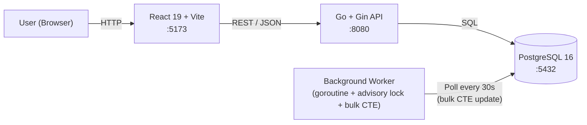
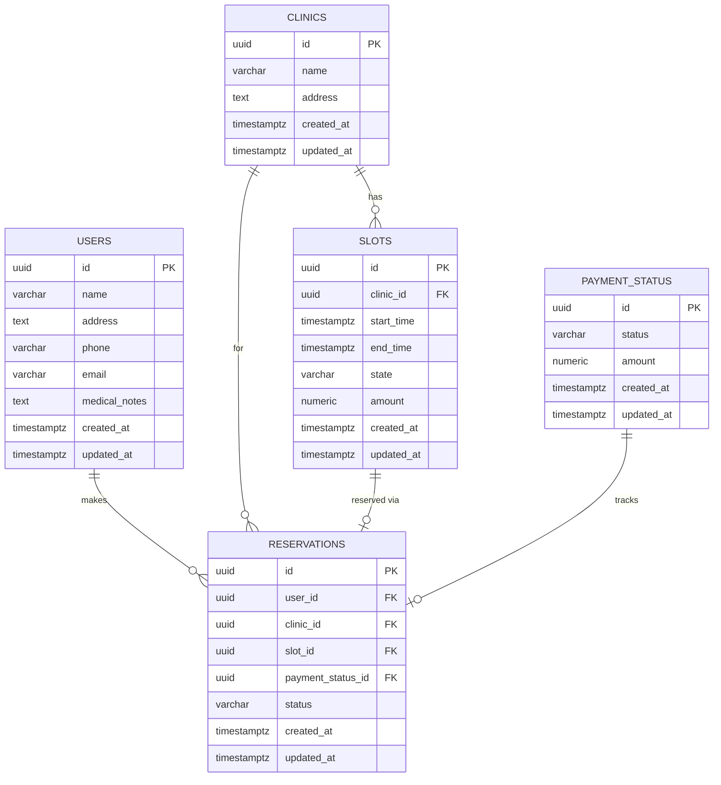
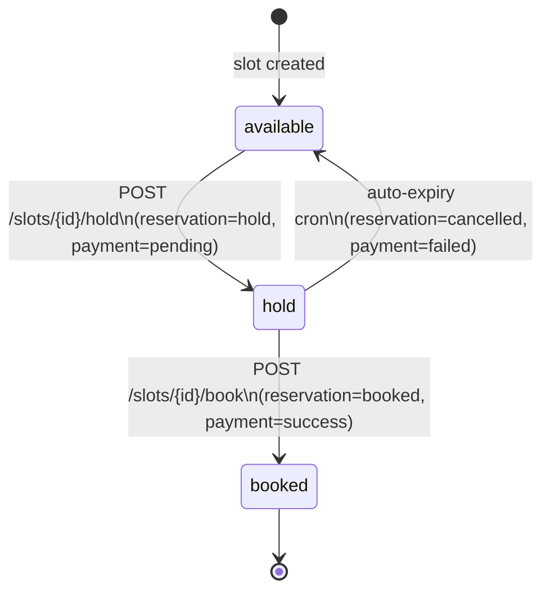

# Low-Level Design (LLD) — Clinic Slot Booking Application

> [!IMPORTANT]
> Stack: **Go + Gin** (Backend) · **PostgreSQL 16** (Database) · **React 19 + TypeScript + Vite** (Frontend)
> Module name: `backend` · Port: `8080` (BE) · `5173` (FE)

---

## Table of Contents
1. [System Overview](#1-system-overview)
2. [Data Models & Database Schema](#2-data-models--database-schema)
3. [Slot & Reservation State Machine](#3-slot--reservation-state-machine)
4. [Backend Project Structure](#4-backend-project-structure)
5. [Database Layer (`db/`)](#5-database-layer-db)
6. [Models (`models/`)](#6-models-models)
7. [Repository Layer (`repository/`)](#7-repository-layer-repository)
8. [Controller Layer (`controller/`)](#8-controller-layer-controller)
9. [Handlers (`handlers/`)](#9-handlers-handlers)
10. [Auto-Expiry Background Worker (Bulk CTE)](#10-auto-expiry-background-worker-bulk-cte)
11. [Router & Middleware (`main.go`)](#11-router--middleware-maingo)
12. [API Contract](#12-api-contract)
13. [Concurrency & Locking Strategy](#13-concurrency--locking-strategy)
14. [Payment Flow (BFF / UI Orchestrated)](#14-payment-flow-bff--ui-orchestrated)
15. [Frontend Architecture](#15-frontend-architecture)
16. [Configuration (`config.yaml`)](#16-configuration-configyaml)
17. [Review Resolutions Summary](#17-review-resolutions-summary)

---

## 1. System Overview



**Key Architectural Decisions:**
- Pure Go binary using standard `database/sql` + `lib/pq` (zero ORM overhead, strictly parameterized queries).
- Slot concurrency handled via **PostgreSQL `SELECT … FOR UPDATE SKIP LOCKED`** to immediately reject duplicate holds without locking connection threads.
- **Audit Preservation**: No reservations are ever deleted. Reservations transition to `cancelled` with full audit retention. Active uniqueness is guarded by a PostgreSQL partial unique index (`WHERE status IN ('hold', 'booked')`).
- **Dynamic Pricing**: Slot amount is stored on each slot record, not hardcoded.
- **Payment Orchestration**: UI / BFF orchestrates with payment providers; `/book` simply verifies the reservation and transitions slot + reservation to `booked` with `payment_status` confirmed.
- **Bulk Cleanup**: Auto-expiry issues a single atomic multi-table CTE query, eliminating DB TPS spikes and round-trip latency.
- **Configuration**: DB pool and connection credentials configured via `config/config.yaml`.

---

## 2. Data Models & Database Schema



### DDL Highlights
- **Slot amounts**: `amount NUMERIC(10,2) NOT NULL DEFAULT 500.00`
- **Reservation status**: `status reservation_state NOT NULL DEFAULT 'hold'`
- **Partial Unique Index**:
```sql
CREATE UNIQUE INDEX uq_active_slot_reservation 
ON reservations(slot_id) 
WHERE status IN ('hold', 'booked');
```

---

## 3. Slot & Reservation State Machine



**State Transitions:**
| Entity | From State | To State | Trigger | Audit Action |
|---|---|---|---|---|
| Slot | `available` | `hold` | `POST /hold` | Reservation created (`status=hold`), PaymentStatus created (`pending`) |
| Slot | `hold` | `booked` | `POST /book` | Reservation updated to `booked`, PaymentStatus updated to `success` |
| Slot | `hold` | `available` | Auto-expiry cron | Reservation updated to `cancelled`, PaymentStatus updated to `failed` (nothing deleted) |

---

## 4. Backend Project Structure

```
backend/
├── main.go                       # Server setup, DI, graceful shutdown
├── config/
│   ├── config.go                 # YAML loader with env override support
│   └── config.yaml               # DB pool & runtime parameters
├── db/
│   ├── db.go                     # DB connection pool initialization
│   └── init.sql                  # Embedded DDL + seeds
├── models/
│   ├── clinic.go
│   ├── slot.go                   # Amount float64 included
│   ├── user.go
│   ├── reservation.go            # Status ReservationState included
│   └── payment.go
├── repository/
│   ├── errors.go
│   ├── clinic_repo.go
│   ├── slot_repo.go
│   ├── reservation_repo.go       # Includes BulkExpireHoldsTx
│   └── payment_repo.go           # CreatePaymentStatusTx
├── controller/
│   ├── errors.go
│   ├── booking_controller.go     # Hold & Book logic
│   └── expiry_controller.go      # Bulk hold expiry
├── handlers/
│   ├── clinic_handler.go
│   ├── slot_handler.go
│   ├── booking_handler.go
│   └── handlers.go
└── worker/
    └── expiry_worker.go          # pg_advisory_lock guarded ticker
```

---

## 5. Bulk Expiry SQL Design

To eliminate per-row loops and DB round trips, hold expiry is executed as a single multi-table CTE query:

```sql
WITH expired_candidates AS (
    SELECT r.id AS res_id, r.slot_id, r.payment_status_id
    FROM reservations r
    JOIN slots s ON s.id = r.slot_id
    WHERE r.status = 'hold'
      AND s.state = 'hold'
      AND r.created_at < NOW() - ($1 || ' seconds')::interval
    FOR UPDATE OF s SKIP LOCKED
),
updated_slots AS (
    UPDATE slots s
    SET state = 'available', updated_at = NOW()
    FROM expired_candidates ec
    WHERE s.id = ec.slot_id
    RETURNING s.id
),
updated_payments AS (
    UPDATE payment_status p
    SET status = 'failed', updated_at = NOW()
    FROM expired_candidates ec
    WHERE p.id = ec.payment_status_id
    RETURNING p.id
),
updated_reservations AS (
    UPDATE reservations r
    SET status = 'cancelled', updated_at = NOW()
    FROM expired_candidates ec
    WHERE r.id = ec.res_id
    RETURNING r.id
)
SELECT count(*) FROM updated_reservations;
```

---

## 6. API Contract

### Endpoints
- `GET /api/v1/clinics` — List all clinics
- `GET /api/v1/clinics/:clinicId` — Get clinic info
- `GET /api/v1/clinics/:clinicId/slots` — Get slots (with `amount`, `state`, `start_time`, `end_time`)
- `POST /api/v1/slots/:slotId/hold` — Hold available slot
  - Request: `{"user_id": "<uuid>"}`
  - Response: `{"reservation_id": "<uuid>", "payment_id": "<uuid>", "amount": 500, "expires_at": "<timestamp>"}`
- `POST /api/v1/slots/:slotId/book` — Finalize booking
  - Request: `{"user_id": "<uuid>", "payment_id": "<uuid>"}`
  - Response: `{"id": "<uuid>", "status": "booked", ...}`

---

## 7. Review Resolutions Summary

| Review Comment | Resolution |
|---|---|
| **1. payment.CreateTx is confusing** | Renamed method in `PaymentRepository` to `CreatePaymentStatusTx`. |
| **2. Amount is hardcoded, should come from slot** | Added `amount` column in `slots` table, mapped in `models.Slot.Amount`, seeded per clinic, and used when creating `PaymentStatus`. |
| **3. Do not call payment provider in book slot** | Removed payment gateway from backend booking flow. Payment orchestration happens on client/BFF. `BookSlot` updates state to `booked` and payment status to `success`. |
| **4. Why cancelSlot?** | Removed `cancelSlot` endpoint and handlers; slots are booked or auto-expire. |
| **5. Do not delete reservations (audit retention)** | Added `status` (`hold`, `booked`, `cancelled`) to `reservations` table with a partial unique index. Cancelled reservations are preserved for auditing. |
| **6. Bulk SQL statement in expire holds** | Replaced per-row transaction iteration with a single multi-table CTE query (`BulkExpireHoldsTx`) running in 1 round trip. |
| **7. DB config in YAML** | Created `config/config.yaml` and loaded connection pool settings into `db.Init`. |
